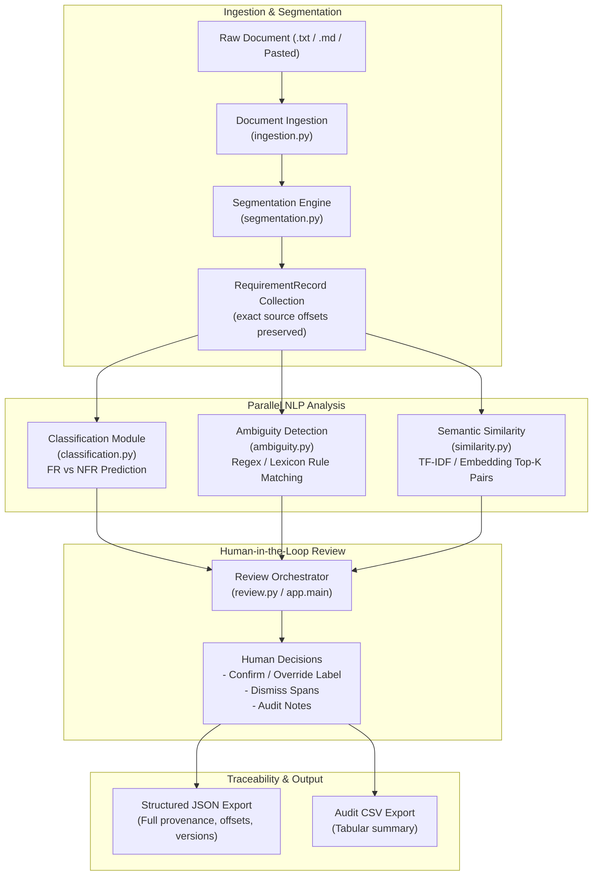

# ReqMind AI — Architecture & Data Flow Specification

**Version:** 1.3
**Status:** Phase 3 Complete (SetFit Transformer & Benchmark)

---

## 1. High-Level System Architecture

```text
+---------------------------------------------------------------------------------+
|                               Input Document                                    |
|               (.txt, .md, pasted text from requirements engineer)               |
+---------------------------------------------------------------------------------+
                                         |
                                         v
+---------------------------------------------------------------------------------+
|                       Ingestion & Text Segmentation                             |
|          - Preserves raw offsets, document ID, and character indices            |
|          - Emits discrete RequirementRecord objects                             |
+---------------------------------------------------------------------------------+
                                         |
        +--------------------------------+--------------------------------+
        |                                |                                |
        v                                v                                v
+-------------------+           +-------------------+           +-------------------+
|   FR / NFR        |           |   Ambiguity       |           |   Semantic        |
|   Classification  |           |   Detection       |           |   Similarity      |
|                   |           |                   |           |                   |
| SetFit Transformer|           | Exact character   |           | Pairwise cosine   |
| (all-MiniLM-L6-v2)|           | spans, rules, and |           | similarity & rank |
| + Fallbacks TF-IDF|           | explanations      |           | top-k candidates  |
| & Heuristics      |           |                   |           |                   |
| (predicted_label, |           |                   |           |                   |
|  model_score)     |           |                   |           |                   |
+-------------------+           +-------------------+           +-------------------+
        |                                |                                |
        +--------------------------------+--------------------------------+
                                         |
                                         v
+---------------------------------------------------------------------------------+
|                   Optional NLI Contradiction Warning (Phase 7)                  |
|               Candidate pair NLI scoring (potential_contradiction flag)         |
+---------------------------------------------------------------------------------+
                                         |
                                         v
+---------------------------------------------------------------------------------+
|                        Human-in-the-Loop Review Engine                          |
|         - Reviewer confirms / overrides predictions (reviewer_label)           |
|         - Dismisses false-positive ambiguities                                  |
|         - Status tracking: PENDING, APPROVED, EDITED, REJECTED                  |
|         - Original model outputs remain immutable                               |
+---------------------------------------------------------------------------------+
                                         |
                                         v
+---------------------------------------------------------------------------------+
|                              Traceable Export                                   |
|                - Full Structured JSON (complete schema & offsets)               |
|                - Flattened CSV (tabular spreadsheet audit report)               |
+---------------------------------------------------------------------------------+
```

---

## 2. Mermaid Workflow Diagram



---

## 3. Data Schema & Provenance Contracts (Pydantic v2)

The system enforces strict typing and validation across all modules:

### RequirementRecord Contract

| Field                        | Type                             | Description                                         |
| :--------------------------- | :------------------------------- | :-------------------------------------------------- |
| `document_id`              | `str`                          | Unique source document identifier                   |
| `requirement_id`           | `str`                          | Requirement identifier (e.g., `REQ-001`)          |
| `raw_text`                 | `str`                          | Exact un-normalized text fragment                   |
| `source_start`             | `int`                          | Start character index in raw document text          |
| `source_end`               | `int`                          | End character index in raw document text            |
| `predicted_label`          | `RequirementLabel`             | Model prediction (`FR` or `NFR`)                |
| `model_score`              | `float`                        | Raw confidence score `[0.0, 1.0]`                 |
| `ambiguities`              | `List[AmbiguitySpan]`          | List of flagged ambiguous terms and explanations    |
| `duplicate_candidates`     | `List[DuplicateCandidate]`     | Top-k similar requirements with similarity score    |
| `contradiction_candidates` | `List[ContradictionCandidate]` | Optional NLI contradiction warnings                 |
| `review_status`            | `ReviewStatus`                 | `pending`, `approved`, `edited`, `rejected` |
| `reviewer_label`           | `RequirementLabel`             | Human correction or confirmation label              |
| `reviewer_notes`           | `str`                          | Notes added during human audit                      |
| `created_at`               | `datetime`                     | UTC timestamp of record creation                    |
| `pipeline_version`         | `str`                          | Release version of ReqMind pipeline                 |
| `model_version`            | `str`                          | Specific model checkpoint name / hash               |

---

## 4. Component Directory Structure

```text
reqmind-ai/
├── app/                       # Streamlit application
│   ├── main.py                # Main UI dashboard and reactive state
│   └── components/            # Reusable Streamlit widgets
├── src/reqmind/               # Core Python package
│   ├── schemas.py             # Pydantic v2 data models
│   ├── ingestion.py           # Document loading and input validation
│   ├── preprocessing.py       # Conservative text normalization
│   ├── segmentation.py        # Offset-preserving segmentation
│   ├── classification.py      # FR / NFR classifiers
│   ├── ambiguity.py           # Ambiguity detection with rule lexicon
│   ├── similarity.py          # TF-IDF & dense vector similarity
│   ├── contradiction.py       # Optional NLI contradiction warnings
│   ├── review.py              # Review state machine & human override logic
│   ├── export.py              # JSON and CSV traceable exporters
│   └── pipeline.py            # End-to-end pipeline coordinator
├── data/
│   ├── raw/                   # Raw datasets (e.g. PROMISE FR/NFR)
│   ├── processed/             # Cleaned datasets
│   ├── annotations/           # Ground truth benchmark annotations
│   ├── splits/                # Frozen train/val/test splits
│   └── sample_requirements.txt# 5 representative benchmark cases
├── models/                    # Serialized local model artifacts (.gitkeep)
├── experiments/               # Training and evaluation benchmarks
├── tests/                     # Automated test suite (pytest)
├── reports/
│   ├── phases/                # Phase milestone exit-gate reports
│   ├── figures/               # Confusion matrices and evaluation plots
│   └── results/               # Metric logs and benchmark runs
├── docs/                      # Architectural and methodology documentation
├── pyproject.toml             # Build system & pytest configuration
├── requirements.txt           # Version-pinned dependencies
├── README.md                  # Project overview and setup instructions
└── .gitignore                 # VCS exclusions
```
