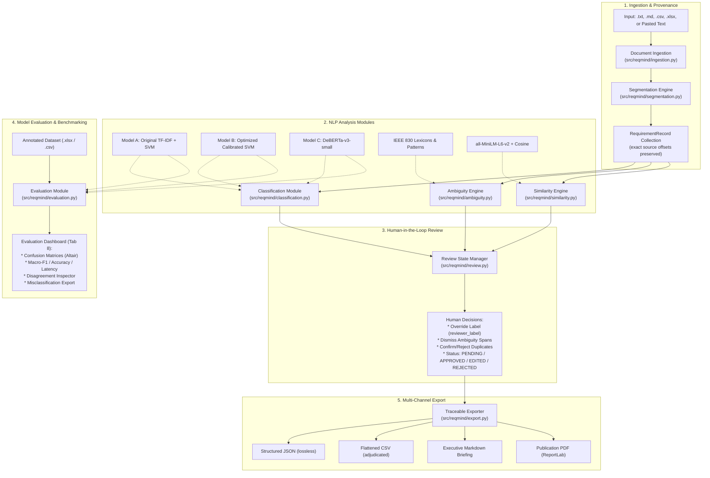

# ReqMind AI — System Architecture & Data Flow Specification

**Version:** 2.0 (Phase 8 Final Release)  
**Status:** Validated, Fully Tested & Production-Grade Academic Architecture  
**Module:** Traitement Automatique du Langage Naturel (TALN)  

---

## 1. High-Level Architecture Overview

ReqMind AI is structured around a modular, non-destructive, provenance-preserving NLP pipeline designed to process, analyze, and audit Software Requirement Specifications (SRS). The system enforces a strict separation between machine inferences and human adjudication, guaranteeing full auditability.

```
+-------------------------------------------------------------------------------------------------------+
|                                        Raw Input Layer                                                |
|            Formats: Raw Text (.txt, .md), Tabular Data (.csv, .xlsx), or Direct UI Input              |
+-------------------------------------------------------------------------------------------------------+
                                                   |
                                                   v
+-------------------------------------------------------------------------------------------------------+
|                                    Ingestion & Provenance Layer                                       |
|  - UTF-8 Validation & Document ID generation (src/reqmind/ingestion.py)                               |
|  - Offset-Preserving Segmentation Engine (src/reqmind/segmentation.py)                                |
|  - Character-exact span tracking: start_char, end_char, source_text                                   |
+-------------------------------------------------------------------------------------------------------+
                                                   |
                   +-------------------------------+-------------------------------+
                   |                               |                               |
                   v                               v                               v
+----------------------------------+ +---------------------------+ +----------------------------------+
|      FR / NFR Classification     | |    Ambiguity Detection    | |   Semantic Duplicate Detection   |
|     (src/reqmind/classification) | |   (src/reqmind/ambiguity) | |      (src/reqmind/similarity)    |
|                                  | |                           | |                                  |
| 1. Original TF-IDF + LinearSVC   | | IEEE 830 Rule Matching:   | | SentenceTransformer Bi-Encoder:  |
| 2. Optimized Calibrated SVM      | | - Vague adverbs & claims  | | - 'all-MiniLM-L6-v2' embeddings  |
| 3. Fine-tuned DeBERTa-v3-small   | | - Non-binding modals      | | - Pairwise Cosine Similarity     |
|                                  | | - Subjective adjectives   | | - Negation & SLA Guard Filters   |
| Outputs: predicted_label, score  | | Outputs: AmbiguitySpan[]  | | Outputs: DuplicateCandidate[]    |
+----------------------------------+ +---------------------------+ +----------------------------------+
                   |                               |                               |
                   +-------------------------------+-------------------------------+
                                                   |
                                                   v
+-------------------------------------------------------------------------------------------------------+
|                                    Human-in-the-Loop Review Engine                                    |
|                                       (src/reqmind/review.py)                                         |
|  - Non-destructive adjudication: reviewer_label overrides without mutating predicted_label            |
|  - False-positive ambiguity span dismissal (dismissed_spans)                                          |
|  - Review status workflow: PENDING -> APPROVED | EDITED | REJECTED                                    |
|  - Review audit metrics & compliance tracking                                                         |
+-------------------------------------------------------------------------------------------------------+
                                                   |
                   +-------------------------------+-------------------------------+
                   |                               |                               |
                   v                               v                               v
+----------------------------------+ +---------------------------+ +----------------------------------+
|       Traceable Export Engine    | |    Model Evaluation Tab   | |       Streamlit Interface        |
|        (src/reqmind/export.py)   | | (src/reqmind/evaluation)  | |         (app/main.py)            |
|                                  | |                           | |                                  |
| - Full Schema JSON (offsets)     | | - Ground-truth benchmarks | | Tab 1: Ingestion & Input         |
| - Tabular Audit CSV (resolved)   | | - Accuracy, Macro-F1, P/R | | Tab 2: Requirements Table        |
| - Executive Markdown Briefing    | | - Confusion Matrix Heatmap| | Tab 3: Ambiguity Inspector       |
| - Publication-Grade PDF Report   | | - Multi-model comparison  | | Tab 4: Duplicate Analysis        |
|   (ReportLab two-pass canvas)    | | - Disagreement inspector  | | Tab 5: Review Workbench          |
|                                  | | - Latency benchmarking    | | Tab 6: Traceable Export          |
|                                  | |                           | | Tab 7: Milestone Benchmarks      |
|                                  | |                           | | Tab 8: Model Evaluation Engine   |
+----------------------------------+ +---------------------------+ +----------------------------------+
```

---

## 2. Detailed Data Flow & Component Interaction



---

## 3. Data Schema & Contracts (Pydantic v2)

All pipeline objects strictly inherit from `pydantic.BaseModel` to ensure schema enforcement, immutable provenance, and type validation:

### 3.1. `RequirementRecord`
```python
class RequirementRecord(BaseModel):
    id: str                                  # Unique identifier (e.g., REQ-001)
    document_id: str                         # Originating document SHA-256 / filename
    text: str                                # Exact segmented requirement text
    start_char: int                          # Absolute character start offset in raw document
    end_char: int                            # Absolute character end offset in raw document
    predicted_label: Optional[str] = None    # FR or NFR
    model_score: Optional[float] = None      # Confidence score [0.0, 1.0]
    reviewer_label: Optional[str] = None     # Human adjudication (None, FR, NFR)
    review_status: ReviewStatus = ReviewStatus.PENDING # PENDING, APPROVED, EDITED, REJECTED
    review_notes: Optional[str] = None       # Reviewer audit commentary
    ambiguities: List[AmbiguitySpan] = []    # Detected quality defect spans
    duplicates: List[DuplicateCandidate] = []# Candidate duplicate relationships
    metadata: Dict[str, Any] = {}            # Model name, version, timestamp
```

### 3.2. `AmbiguitySpan`
```python
class AmbiguitySpan(BaseModel):
    start_char: int                          # Relative start offset within requirement text
    end_char: int                            # Relative end offset within requirement text
    text: str                                # The matched ambiguous token/phrase
    category: AmbiguityCategory              # VAGUENESS, SUBJECTIVITY, NON_BINDING_MODAL, WEAK_PROP
    explanation: str                         # IEEE 830 actionable clarification guideline
    dismissed: bool = False                  # False-positive flag set by human reviewer
```

### 3.3. `DuplicateCandidate`
```python
class DuplicateCandidate(BaseModel):
    target_id: str                           # Target requirement ID
    similarity_score: float                  # Pairwise cosine similarity [0.0, 1.0]
    is_negation_conflict: bool = False       # Flagged if modal polarity differs
    is_sla_conflict: bool = False            # Flagged if numeric bounds contradict
    status: DuplicateStatus = DuplicateStatus.UNREVIEWED # UNREVIEWED, CONFIRMED, REJECTED
```

---

## 4. Classification Engine Architecture

The classification subsystem (`src/reqmind/classification.py`) implements a polymorphic design supporting three local inference backends:

| Property | Model 1: Baseline SVM | Model 2: Calibrated SVM | Model 3: DeBERTa-v3-small |
| :--- | :--- | :--- | :--- |
| **Architecture** | Word TF-IDF + LinearSVC | Word+Char TF-IDF + CalibratedClassifierCV | Fine-Tuned Transformer (Cross-Encoder) |
| **Feature Extraction** | Word n-grams (1, 2) | Word (1, 2) + Char (3, 5) n-grams | Disentangled Attention Embeddings |
| **Class Weighting** | Uniform | Balanced (`balanced`) | Cross-Entropy Loss with Label Smoothing |
| **Probability Estimation** | Synthetic sigmoid approximation | Platt Scaling (Calibrated Sigmoid) | Softmax over logits |
| **Latency (CPU)** | **~0.05 – 0.46 ms / req** | **~0.28 – 0.35 ms / req** | **~14.66 – 23.37 ms / req** |
| **Benchmark Accuracy (60-Set)** | 76.7% | 80.0% | **96.7%** |
| **Benchmark Macro-F1 (60-Set)** | 76.6% | 79.8% | **96.7%** |

---

## 5. Ambiguity & Quality Detection Engine

The ambiguity engine (`src/reqmind/ambiguity.py`) applies deterministic regex rule hierarchies based on IEEE 830 guidelines:
1. **Vagueness / Fuzzy Adverbs:** Identifies non-verifiable adverbs (`approximately`, `quickly`, `regularly`, `efficiently`, `promptly`).
2. **Subjectivity & User-Experience Claims:** Detects unquantified claims (`user-friendly`, `easy to use`, `intuitive`, `flexible`, `state-of-the-art`).
3. **Non-Binding Modals:** Flags requirements failing RFC 2119 / IEEE 830 normativity (`should`, `could`, `may`, `might` instead of `shall` / `must`).
4. **Weak Proportionality:** Identifies vague conditionals (`as appropriate`, `if feasible`, `to the extent possible`).

Every detected defect preserves character-exact spans for UI highlighting and supports human dismissal without modifying original text.

---

## 6. Semantic Duplicate & Near-Duplicate Ranking

The duplicate detection engine (`src/reqmind/similarity.py`) operates via dense bi-encoder sentence representations:
1. **Sentence Embeddings:** Generated locally using `sentence-transformers/all-MiniLM-L6-v2` (384-dimensional dense vectors).
2. **Pairwise Cosine Distance:** Vectorized dot-product scoring across all requirement pairs.
3. **Guard Filters:**
   - **Negation Guard:** Flags pairs that contain opposing polarity tokens (`not`, `never`, `cannot`).
   - **SLA / Numeric Guard:** Prevents false-equivalence between requirements sharing text patterns but differing in numeric performance metrics (e.g., "500ms" vs "2000ms").
4. **Adjudication Interface:** Allows human engineers to confirm true duplicates or dismiss false candidates.

---

## 7. Model Evaluation & Benchmarking Engine

The evaluation module (`src/reqmind/evaluation.py` and Streamlit Tab 8) provides an empirical testing suite:
- **Dataset Ingestion:** Validates uploaded Excel/CSV files for required columns (`Requirement_ID`, `Requirement_Text`, `Gold_Label`), checks for missing values, unsupported labels, and duplicate IDs.
- **Metric Computation:** Computes Accuracy, Macro-F1, Precision, Recall, Class-specific F1 (FR-F1, NFR-F1), and full $2 \times 2$ Confusion Matrices.
- **Side-by-Side Comparison:** Evaluates multiple models against identical ground-truth datasets with identical seeds.
- **Disagreement Inspector:** Isolates requirements where selected models disagree with ground truth or with each other.
- **Export Capabilities:** Exports detailed prediction sheets and comparative metrics in CSV or Excel formats.

---

## 8. Export & Reporting Subsystem

The export engine (`src/reqmind/export.py`) ensures complete end-to-end traceability:
- **Lossless JSON Export:** Preserves complete Pydantic schemas, document offsets, model scores, review statuses, and human notes. Includes a round-trip programmatic validator.
- **Flattened CSV Export:** Generates clean tabular spreadsheets with resolved final labels for requirement management tools (Jira, DOORS).
- **Executive Markdown Briefing:** Summarizes requirement distributions, review metrics, quality defect counts, and candidate duplicate pairs.
- **Publication-Quality PDF:** Built via ReportLab with a custom two-pass `_NumberedCanvas` for exact page numbering ("Page X of Y"), executive KPI summary cards, color-coded status badges, and itemized audit tables.
