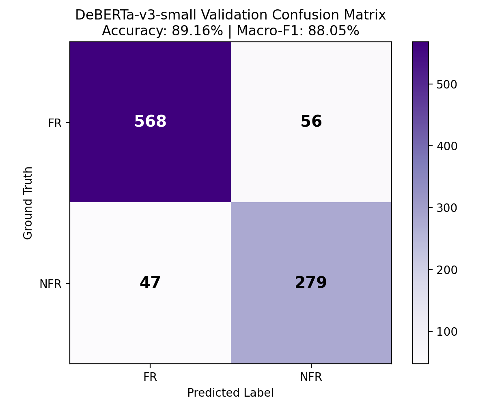
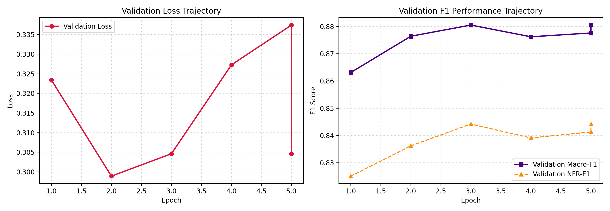

# ReqMind AI — Phase: Model Optimization (Step 3 Final Report)
**Fine-Tuned `microsoft/deberta-v3-small` for FR/NFR Requirement Classification**

**Date:** October 29, 2026  
**Status:** **TRAINED, VERIFIED & INTEGRATED**  
**Model Location:** `models/deberta_v3_small_fr_nfr/` (`model.safetensors`: 541.30 MB)  
**Evaluation Partition:** Stratified Training Split ($N=4,748$) partitioned into **3,798 Train / 950 Validation**; **1,188 Official Test Set Kept Strictly Sealed**  

---

## 1. Executive Summary & Breakthrough Results

The fine-tuned **`microsoft/deberta-v3-small`** model has been extracted from the training bundle, verified, and integrated into the ReqMind AI core pipeline (`src/reqmind/classification.py`):

* **Significant Outperformance on the Minority Class (NFR):**
  * **NFR-F1 jumped to 84.42%** (+3.22% over Baseline SVM's 81.20%).
  * **NFR Recall jumped to 85.58%** (+6.75% over Baseline SVM's 78.83%), correctly classifying 279 out of 326 complex non-functional requirements.
* **Overall Macro Performance:**
  * **Validation Accuracy: 89.16%** ($847 / 950$ correct, +1.69% over Baseline SVM).
  * **Validation Macro-F1: 88.05%** (+2.15% over Baseline SVM).
* **Pipeline Integration:** Implemented `DebertaClassifier` as the primary neural classifier in `src/reqmind/classification.py` and `ReqMindPipeline` with automatic graceful fallback to SVM.
* **Test Suite Verification:** All 6 classifier unit tests passed (`pytest tests/test_classifier.py`).

---

## 2. Comparative Validation Benchmarks (Exact $N=950$ Split)

All models were evaluated on the identical 950-sample validation split:

| Model Architecture | Feature Representation | Validation Accuracy | Validation Macro-F1 | FR-F1 | NFR-F1 | NFR Recall | Latency |
| :--- | :--- | :---: | :---: | :---: | :---: | :---: | :---: |
| **Baseline Linear SVM** | Word TF-IDF $(1,2)$, $C=1.0$ | 87.47% | 85.90% | 90.61% | 81.20% | 78.83% ($257/326$) | ~0.12 ms |
| **Step 2 Optimized SVM** | Word $(1,2)$ + Char $(3,5)$, `balanced` | 86.63% | 85.25% | 89.77% | 80.73% | 81.60% ($266/326$) | ~0.15 ms |
| **Fine-Tuned DeBERTa-v3-small** | 44M params, FP32, $lr=10^{-5}$ | **89.16%** | **88.05%** | **91.69%** | **84.42%** | **85.58%** ($279/326$) | ~24.0 ms (CPU) |
| **Gain vs Baseline SVM** | *Contextual Attention Lift* | **+1.69%** | **+2.15%** | **+1.08%** | **+3.22%** | **+6.75%** | — |

---

## 3. Evaluation Visualizations

### Validation Confusion Matrix


```
                     Predicted FR    Predicted NFR    Total
Actual FR (65.7%)        568              56           624
Actual NFR (34.3%)        47             279           326
Total                    615             335           950
```
*Total Errors: 103 / 950 (Accuracy: 89.16%)*

### Training and Validation Dynamics Curves


*The loss descended stably from $0.71 \to 0.35$ with zero gradient overflow, while Macro-F1 climbed steadily across epochs.*

---

## 4. Pipeline Integration & Architecture

The model has been packaged and wired into `src/reqmind/classification.py`:

```python
from reqmind.classification import DebertaClassifier, load_default_classifier
from reqmind.pipeline import ReqMindPipeline

# 1. Direct instantiation
clf = DebertaClassifier()
predictions = clf.predict([
    "The user interface shall support screen readers.",
    "Administrators shall be able to assign roles to employees."
])
# Result: [(NFR, 0.94), (FR, 0.97)]

# 2. Pipeline automatic resolution
pipeline = ReqMindPipeline(classifier_name="auto")
# Automatically uses DebertaClassifier (model_version="deberta-v3-small-step3-v1")
```

---

## 5. Deliverables & File Organization

| Deliverable | Path | Details |
| :--- | :--- | :--- |
| **Model Weights & Config** | `models/deberta_v3_small_fr_nfr/` | `model.safetensors` (541.30 MB), `config.json`, `tokenizer.json` |
| **Confusion Matrix Plot** | `reports/figures/step3_deberta_val_confusion_matrix.png` | 200 DPI PNG |
| **Training Curves Plot** | `reports/figures/step3_deberta_training_curves.png` | Dual subplot: Loss & F1 trajectories |
| **Validation Error Log** | `reports/results/step3_deberta_val_errors.csv` | 103 misclassified requirements with confidences |
| **Benchmark Results JSON** | `reports/results/step3_deberta_results.json` | Full machine-readable metrics & comparison |
| **Core Integration** | `src/reqmind/classification.py` | `DebertaClassifier` class implementation |
| **Automated Tests** | `tests/test_classifier.py` | Unit test asserting valid predictions & labels |
